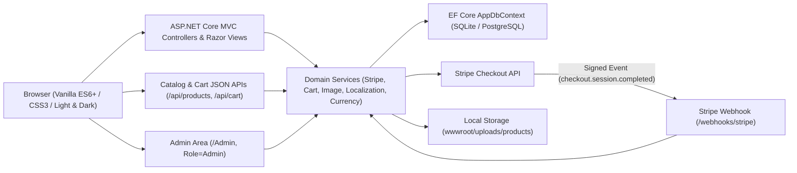
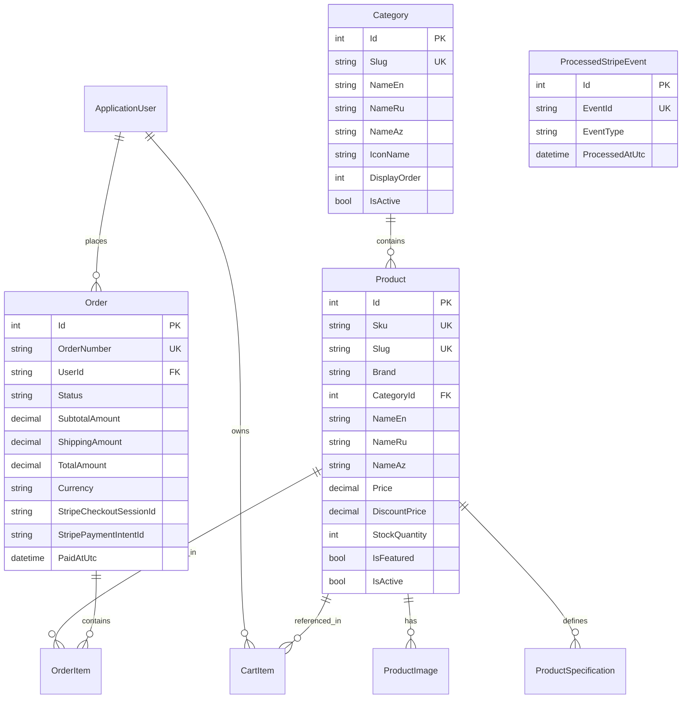

# TechStore — Production E-Commerce Platform Implementation Plan

> **Status**: Approved (`net10.0` LTS, zero hardcoded secrets via `user-secrets`/env vars + dev console one-time bootstrap password, local theme-compatible SVG product illustrations + validated raster Admin uploads).

## Goal Description
Build **TechStore**, a production-ready, full-stack e-commerce web application for selling electronics, laptops, PC components, monitors, storage, and computer peripherals from scratch in `c:\Projects\TechStore`.

The application is engineered with **ASP.NET Core MVC (.NET 10 LTS)**, **Entity Framework Core** (zero-config SQLite locally, one-setting switch to PostgreSQL in production), **ASP.NET Core Identity** (`Admin` / `Customer` roles), **Stripe Checkout + verified webhooks**, **trilingual localization (`ru`, `az`, `en`)** with **AZN** default currency, and a minimalist high-craft **vanilla CSS3 + ES6+ JS** frontend (strictly zero Bootstrap, Tailwind, or jQuery) featuring instant Light/Dark theming and animated skeleton loaders.

---

## Approved Architectural Decisions

1. **Target Framework (`net10.0` LTS)**: Matches the local `.NET SDK 10.0.204` and `dotnet-ef 11.0.0` natively, targeting `mcr.microsoft.com/dotnet/sdk:10.0` and `aspnet:10.0` in Docker.
2. **Zero Hardcoded Secrets**:
   - **Stripe** (`Stripe:SecretKey`, `Stripe:PublishableKey`, `Stripe:WebhookSecret`) is loaded exclusively from environment variables or `dotnet user-secrets`.
   - **Admin Seeder** reads `SeedAdmin:Email` (default `admin@techstore.local`) and `SeedAdmin:Password` from configuration/environment/user-secrets. In `Development`, if `SeedAdmin:Password` is unset on initial seed, a one-time cryptographically strong password is generated and logged clearly to the startup console. Production requires `SeedAdmin__Password` explicitly.
3. **Seeded Imagery & Admin Uploads**:
   - All 16 seeded hardware products bundle locally authored, theme-compatible minimalist SVG illustrations under `wwwroot/images/products/`.
   - Admin uploads accept validated `.jpg`, `.jpeg`, `.png`, and `.webp` images (5 MB cap, extension + MIME + magic-byte validation, GUID filenames) stored under `wwwroot/uploads/products/`.

---

## System Architecture



### Entity Relationship Diagram



### Core Technical Patterns

1. **Single `AppDbContext` for SQLite + PostgreSQL**:
   - Single `DbContext` ensures `dotnet ef database update` runs cleanly without `--context`.
   - `Database:Provider` (`Sqlite` default, `PostgreSQL` for production) switches database providers cleanly.
   - All timestamps strictly use `DateTime.UtcNow` (`Kind=Utc`) for Npgsql compatibility.
   - Conditional SQLite `decimal -> double` converter in `OnModelCreating` enables SQL-level sorting, range filters, and `SUM` on SQLite while PostgreSQL retains native `numeric(18,2)`.
2. **Structured JSON Localization (`en`, `ru`, `az`)**:
   - Custom `JsonStringLocalizer` + `JsonStringLocalizerFactory` integrated with `UseRequestLocalization` and `CookieRequestCultureProvider`.
   - Translations live in `Resources/en.json`, `Resources/ru.json`, `Resources/az.json` with 100% key parity verified automatically.
   - Client-side subset serialized to `window.TechStoreI18n` so JS components contain zero hardcoded strings.
3. **Cart Persistence & Guest-to-User Merge**:
   - Guests use an `HttpOnly`, `SameSite=Lax` cookie (`ts_cart_sid`) backed by `CartItems` in DB plus a client `localStorage` snapshot for instant UI hydration and cross-tab sync.
   - Login/registration merges guest items into the authenticated DB cart clamped to live stock.
4. **Authoritative & Idempotent Stripe Webhook**:
   - `POST /webhooks/stripe` validates `Stripe-Signature` via `EventUtility.ConstructEvent`.
   - Deduplicates via `ProcessedStripeEvents` table.
   - Atomically decrements `Product.StockQuantity` via parameterized SQL inside a transaction, marks `Order.Status = Paid`, and clears the buyer's cart.
5. **Security & Validation**:
   - Global `[AutoValidateAntiforgeryToken]` across MVC/API mutations (only `/webhooks/stripe` opts out in favor of Stripe HMAC verification).
   - `ImageService` enforces 5 MB size cap, extension allowlist (`.jpg`, `.jpeg`, `.png`, `.webp`), MIME check, binary magic-byte header inspection, and GUID filenames.
   - Strictly zero Bootstrap, Tailwind, or jQuery anywhere.

---

## Project Directory Structure

```text
c:\Projects\TechStore\
├── TechStore.csproj
├── Program.cs
├── appsettings.json
├── appsettings.Development.json
├── Dockerfile
├── docker-compose.yml
├── .env.example
├── .gitignore
├── PLAN.md
├── README.md
├── Areas/Admin/
│   ├── Controllers/{Dashboard,Products,Categories,Orders,Customers}Controller.cs
│   └── Views/
│       ├── Shared/_AdminLayout.cshtml
│       ├── Dashboard/Index.cshtml
│       ├── Products/{Index,Create,Edit}.cshtml
│       ├── Categories/{Index,Create,Edit}.cshtml
│       ├── Orders/{Index,Details}.cshtml
│       └── Customers/Index.cshtml
├── Controllers/
│   ├── HomeController.cs
│   ├── CatalogController.cs
│   ├── ProductsApiController.cs
│   ├── CartController.cs
│   ├── CartApiController.cs
│   ├── CheckoutController.cs
│   ├── StripeWebhookController.cs
│   ├── AccountController.cs
│   └── LocalizationController.cs
├── Data/
│   ├── AppDbContext.cs
│   ├── DbSeeder.cs
│   └── Migrations/InitialCreate.cs
├── Models/
│   ├── ApplicationUser.cs
│   ├── Category.cs
│   ├── Product.cs
│   ├── ProductImage.cs
│   ├── ProductSpecification.cs
│   ├── CartItem.cs
│   ├── Order.cs
│   ├── OrderItem.cs
│   ├── OrderStatus.cs
│   └── ProcessedStripeEvent.cs
├── Options/{StoreOptions,StripeOptions}.cs
├── Services/
│   ├── Localization/{JsonStringLocalizer,JsonStringLocalizerFactory,LocalizationHelper}.cs
│   ├── ICurrencyFormatter.cs / CurrencyFormatter.cs
│   ├── ICartService.cs / CartService.cs
│   ├── IStripeCheckoutService.cs / StripeCheckoutService.cs
│   ├── IImageService.cs / ImageService.cs
│   └── IProductCatalogService.cs / ProductCatalogService.cs
├── ViewModels/...
├── Resources/{en,ru,az}.json
├── Views/...
├── wwwroot/
│   ├── css/{tokens,base,layout,components,pages,admin}.css
│   ├── js/{core,theme,nav,cart,catalog,product-detail,admin}.js
│   ├── images/products/*.svg
│   └── uploads/products/.gitkeep
└── tests/TechStore.Tests/...
```

---

## 5-Milestone Execution Plan

1. **Milestone 1 — Foundation, EF Core + SQLite, Identity, Localization, Seeder & Base Layout**
   - `TechStore.csproj` (`net10.0`), `Program.cs`, `appsettings.json`, `Options/`, all 10 Models, `AppDbContext` + `InitialCreate` migration, ASP.NET Core Identity (`Admin`/`Customer`), JSON localization (`en`/`ru`/`az`) + `LocalizationController` + `CurrencyFormatter` (`AZN`), `DbSeeder` (roles, Admin account, 6 categories, 16 trilingual products + local SVG product artwork), Base Layout (`_Layout`, `_Header`, `_Footer`, zero-flicker Light/Dark theme switcher, RU/AZ/EN switcher, minimalist CSS3 design system).
   - Gate: `dotnet build`, `dotnet ef database update`, clean app boot with zero errors.
2. **Milestone 2 — Storefront Homepage, Async Catalog API + Skeleton Loading & Product Detail Page**
   - `ProductCatalogService`, `HomeController` + full storefront homepage, `CatalogController`, `ProductsApiController` (`GET /api/products`), `catalog.js` with shimmer skeleton loading, live search, category/brand/price/in-stock filters, sorting, pagination, URL sync, mobile filter drawer, Product Detail page with gallery/lightbox, localized spec table, stock badges, related products.
   - Gate: `dotnet build` with zero warnings/errors.
3. **Milestone 3 — Persistent Cart Drawer, Real Stripe Checkout & Webhook, Customer Account & Orders**
   - `CartService` (DB + guest cookie + `localStorage` sync + login merge), `CartApiController`, `CartController`, slide-over `_CartDrawer` + `cart.js`, `StripeCheckoutService`, `CheckoutController`, `StripeWebhookController` (`/webhooks/stripe` with signature verification, idempotency, atomic stock decrement), `AccountController` (Register, Login, Logout, Profile & Address, Order History & live Order Status tracker).
   - Gate: `dotnet build` with zero warnings/errors.
4. **Milestone 4 — Admin Panel (`/Admin` Area, `[Authorize(Roles = "Admin")]`)**
   - `_AdminLayout`, `admin.css`, `admin.js`, Dashboard KPIs + low-stock alerts + recent orders, `ImageService` (magic-byte + MIME + 5 MB validation), Product CRUD (trilingual fields, dynamic spec rows, multi-image upload), Category CRUD, Order Management (filtering & status updates), Customer Overview.
   - Gate: `dotnet build` with zero warnings/errors.
5. **Milestone 5 — Docker Deployment, Documentation & Full End-to-End Verification**
   - `Dockerfile`, `docker-compose.yml`, `.env.example`, `README.md`, automated `tests/TechStore.Tests` (localization parity, image validation, catalog API, cart merge, Stripe webhook signature/idempotency/stock decrement, Admin RBAC), plus live end-to-end verification in browser.
   - Gate: `dotnet build --warnaserror`, `dotnet ef database update`, `dotnet test tests/TechStore.Tests`, and full browser verification.
